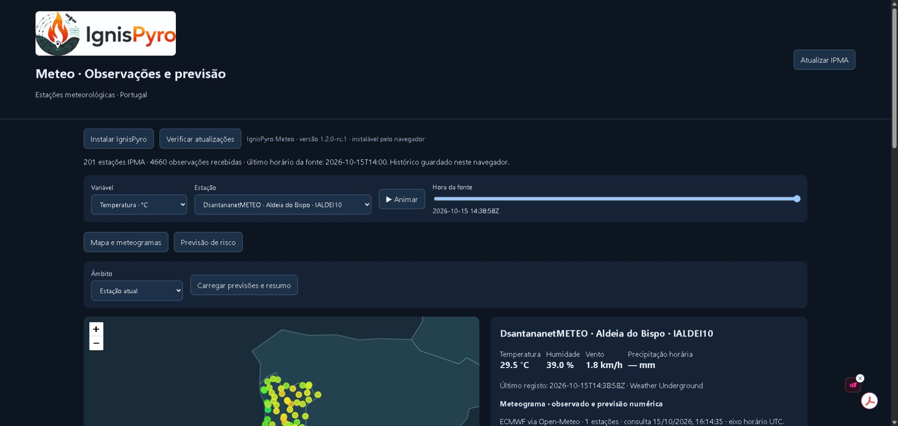

# IgnisPyro Meteo

Aplicação meteorológica para consultar observações de estações em Portugal, explorar um mapa,
visualizar meteogramas ECMWF via Open-Meteo e exportar CSV/GeoJSON. Integra a estação
Aldeia do Bispo (IALDEI10) e mantém o Borda d’Água digital para agronomia. Não depende da linguagem FlameLang.

## Descarregar e instalar

| Versão | Ligação | Como utilizar |
| --- | --- | --- |
| **Windows 10/11 · instalador x64** | [Descarregar EXE](https://github.com/dsantananet/ignispyro-meteo/releases/download/v1.2.0-rc.3/IgnisPyroMeteo-1.2.0-rc.3-windows-x64-setup.exe) | Executar e seguir o assistente. |
| **Windows · portátil x64** | [Descarregar ZIP portátil](https://github.com/dsantananet/ignispyro-meteo/releases/download/v1.2.0-rc.3/IgnisPyroMeteo-1.2.0-rc.3-windows-x64-portable.zip) | Extrair o ZIP e executar IgnisPyroMeteo.exe; não requer instalação. |
| **Android · instalar pelo Chrome (PWA)** | [Abrir versão online](https://dsantananet.github.io/ignispyro-meteo/) | Chrome → ⋮ → Adicionar ao ecrã principal → Instalar. |
| **Android 8+ · APK experimental** | [Descarregar APK](https://github.com/dsantananet/ignispyro-meteo/releases/download/android-preview/IgnisPyroMeteo-android-experimental.apk) · [Estado da compilação](https://github.com/dsantananet/ignispyro-meteo/actions/workflows/android.yml) | Abrir o APK e autorizar a instalação por este navegador quando o Android pedir. |
| **Online · computador, telemóvel e tablet** | [Abrir no navegador](https://dsantananet.github.io/ignispyro-meteo/) · [Estado da publicação](https://github.com/dsantananet/ignispyro-meteo/actions/workflows/online.yml) | Sem descarregar nem instalar programas. |

[Todos os ficheiros e versões](https://github.com/dsantananet/ignispyro-meteo/releases).
Windows atualizado para a versão candidata 1.2.0-rc.3, com tefigramas integrados. **APK Android 1.2.0-rc.3 com tefigramas publicado**: compilação, lint e publicação [concluídos com sucesso](https://github.com/dsantananet/ignispyro-meteo/actions/runs/39066053480). **Online/PWA ativo**: [abrir IgnisPyro Meteo](https://dsantananet.github.io/ignispyro-meteo/). Publicação verificada com sucesso em 17/10/2026.

### Versão online ativa

Abra https://dsantananet.github.io/ignispyro-meteo/. No Android, utilize Chrome → Instalar aplicação ou Adicionar ao ecrã principal. GitHub Pages está configurado para GitHub Actions; alterações à interface são publicadas automaticamente pelo fluxo Online · Android PWA.

### Android: qual escolher?

**Recomendado: PWA pelo Chrome**, com atualizações da interface e sem permissões de instalação de APK. Abra a versão online, aguarde a primeira carga e use **Instalar aplicação** ou o menu do Chrome. A interface e o histórico já guardado ficam disponíveis offline; novas observações e previsões exigem Internet. O histórico é específico de cada navegador/dispositivo.

O **APK experimental** inclui a interface e permite exportar CSV/GeoJSON pelo seletor de ficheiros Android. Requer Android System WebView atualizado. Tem assinatura de desenvolvimento e ainda necessita de validação num dispositivo real; não é uma versão de produção nem uma publicação na Play Store. Se o cache da assinatura expirar, uma atualização poderá exigir reinstalação: exporte primeiro o histórico. Não há permissões de localização ou acesso geral ao armazenamento.

**Estações pessoais:** online e Android consultam a Aldeia do Bispo pelo resumo público, sem pedir chaves. Adicionar outras estações Weather Underground requer a aplicação Windows local; o botão aparece desativado nos outros ambientes.

## Instalação para utilizadores

A versão experimental Windows x64 está publicada em [Releases](https://github.com/dsantananet/ignispyro-meteo/releases/tag/v1.2.0-rc.3), com instalador, ZIP portátil, instruções e SHA256.
Descarregue `IgnisPyroMeteo-…-windows-x64-setup.exe`, execute o assistente e abra IgnisPyroMeteo
no menu Iniciar. Python, Node.js e Git não são necessários.
O painel abre no navegador; mantenha a pequena janela IgnisPyro Meteo aberta.
Desinstalação: Definições → Aplicações → IgnisPyroMeteo.
O ZIP de código-fonte não é um instalador.

## Como utilizar

1. Clique em Atualizar IPMA e aguarde as observações.
2. Escolha variável, estação e horário; consulte mapa e meteogramas de temperatura, humidade, vento, rajadas, chuva, pressão, nebulosidade e ponto de orvalho.
3. Escolha uma estação, uma seleção ou todas, e carregue as previsões. No separador **Previsão de risco**, copie o boletim para análise de incêndios ou partilha no Telegram. Não são enviadas mensagens. Exporte observações em CSV/GeoJSON e previsões em CSV separado.
4. Feche a janela de controlo para terminar o servidor local.

## Requisitos e estado

Pacote candidato para Windows 10/11 x64 e navegador moderno. Usa apenas a interface local 127.0.0.1,
porta 8765; Internet é necessária para obter novas observações. Histórico guardado no navegador.
Instalação, dois arranques e desinstalação passaram num runner Windows novo e no Windows local, com os ficheiros descarregados da Release. Linux e macOS não foram testados.

## Funcionalidades e limitações

IPMA não requer chave. IALDEI10 integra a lista comum. Neste computador, a credencial fica no Gestor de Credenciais do Windows, fora do repositório e do instalador. A distribuição consulta também `data/aldeia.json`, atualizado pelo fluxo **Aldeia do Bispo observations**, que requer o segredo de repositório `WU_API_KEY`. Os agendamentos podem sofrer atrasos; a hora real da observação é sempre preservada.

**Adicionar estação pessoal** pede identificador e chave para cada nova ligação. A chave é usada em memória pelo servidor local e não é guardada no navegador. Chuva diária WU nunca é apresentada como chuva horária.

O boletim identifica calor, secura, vento e coincidências nas próximas 24 horas; os meteogramas cobrem 72 horas. O resumo nacional cobre as estações carregadas, não toda a superfície do país. Não calcula FWI oficial, não prevê propagação de incêndios e não substitui avisos oficiais, avaliação de combustível, relevo e condições no terreno. Dados em falta não são zeros.

Previsão [ECMWF via Open-Meteo](https://open-meteo.com/en/docs/ecmwf-api), com atribuição CC BY 4.0 e sujeita às condições/limites do serviço gratuito. Azul: observado; laranja tracejado: modelo. Valores passados do modelo não são observações nem previsões históricas arquivadas para validação. Modelo e WU usam UTC; a API IPMA não explicita o fuso das observações, pelo que o alinhamento UTC é provisório e indicado no painel. Não medir erros de previsão sem confirmar esse alinhamento.
O histórico permanece no navegador após desinstalar, para evitar apagar observações do utilizador.

## Para programadores

Python 3.12+ e Node.js 22 para testes. `python desktop.py` abre a aplicação.
`node --test tests/*.test.mjs`; `python -m unittest discover -s tests`.
Os testes de cifragem requerem `requirements-meteo-crypto.txt`.
Para compilar no Windows: instale `requirements-build.txt`, execute `python packaging/build.py`
e compile `packaging/windows.iss` com Inno Setup 6.7.3.
O guia [METEO.md](METEO.md) mantém detalhes históricos; os comandos de desenvolvimento não são necessários
para instalar o pacote autónomo. Conteúdos antigos sobre alojamento FlameLang devem ser revistos antes da migração pública.

## Novidades do candidato 1.2.0-rc.3

Separação do projeto, arranque gráfico, pacote Windows autónomo e restrição de acesso HTTP aos recursos do painel.
A versão candidata não é uma Release estável.

## Licença e contacto

Licença [MIT](LICENSE), conforme declaração original; [avisos](LEGAL-NOTICE.md). Leaflet conserva a licença original.
Contacto: [dsantananet](https://github.com/dsantananet); problemas em Issues deste repositório.

## Perfil vertical / Tefigrama (experimental)

Na estação selecionada, abrir **Perfil vertical / Tefigrama** e carregar o perfil. A previsão GFS Global (NOAA), via Open-Meteo, disponibiliza 48 horas UTC, temperatura, ponto de orvalho, altura geopotencial e vento em 16 níveis entre 1000 e 100 hPa. Níveis abaixo da pressão de superfície são excluídos. CAPE e CIN são fornecidos pelo modelo, sem reconstrução da parcela. O gráfico usa coordenadas T–entropia e mostra isóbaras e adiabáticas secas. A tabela e a exportação CSV preservam valores ausentes. SVG disponível no navegador.

A localização/altitude da grelha e a distância à estação são indicadas; a altitude real da estação não é fornecida pelo catálogo atual. Não é uma radiossondagem observada. O ciclo de inicialização não é fornecido por esta resposta da API. LCL/LFC, trajetória da parcela, adiabáticas saturadas e Haines ainda não implementados. Inversões só são detetadas entre níveis válidos adjacentes, podendo faltar camadas finas. Novos dados requerem Internet e estão sujeitos aos limites Open-Meteo. Fonte: https://open-meteo.com/en/docs/gfs-api (CC BY 4.0).

Validação: 24 testes JavaScript e 8 Python passaram. Teste Chrome passou com seleção horária, exportação CSV, dados ausentes, exclusão de níveis sob a superfície e largura móvel. Capturas desktop/móvel verificadas. Consulta real GFS em 40°N, 7°W devolveu HTTP 200 e perfis válidos. APK ainda requer teste em dispositivo físico; não constitui validação científica operacional.

## Leitura do tefigrama para incêndios rurais

A versão 1.2.0-rc.3 acrescenta quatro descrições que acompanham a estação e a hora: convecção ambiente (CAPE/CIN), secura relativa nos níveis 950–700 hPa, inversões entre níveis válidos adjacentes e vento até 3000 m acima do terreno do modelo. A área Previsão de risco apresenta também esta leitura, explicitamente referente ao perfil selecionado e independente do âmbito multiestação do boletim. Não é atribuída classe de risco nem probabilidade de comportamento extremo. CAPE nulo não exclui convecção do incêndio; vento em altitude não é vento à superfície.

Base conceptual: NWCG, Atmospheric Stability (https://www.nwcg.gov/publications/pms425-1/4-atmospheric-stability) e Critical Fire Weather (https://www.nwcg.gov/publications/pms437/weather/critical-fire-weather). Sem limiares calibrados ou previsão da rutura de inversões. Confrontar com combustíveis, humidade, seca, relevo, vento observado e avisos oficiais.
